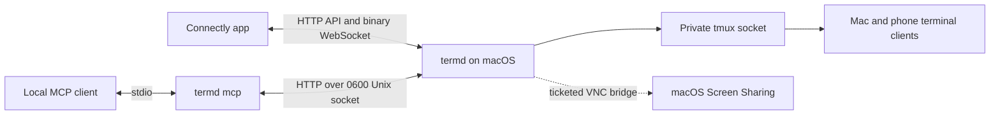

<p align="center">
  
</p>

<h1 align="center">Connectly</h1>

<p align="center">A native mobile terminal for your Mac. Run any CLI over a private connection, without SSH.</p>

<p align="center">Go · Expo · React Native · xterm.js · WebSocket</p>

## Why I built it

I use OpenCode a lot, but its remote workflow was not reliable enough for daily work. I tried three native apps and still wanted a simpler boundary. Codex has a native route, but it is not the CLI I use most. I wanted to reach the Mac's shell and run OpenCode, Codex, or any other CLI there. The terminal should belong to the machine, not to one tool.

Connectly gives me that path from a phone. A private tmux server owns remote terminal sessions on the Mac, and the Go daemon attaches the phone as another terminal client. The app connects over a private network, with no SSH server, CLI-specific bridge, or hosted relay in the middle.

## Architecture



The Expo app uses React Native for its interface and xterm.js in a WebView for terminal rendering. The daemon manages a dedicated tmux socket, attaches each phone tab through a PTY, and keeps the existing binary-framed WebSocket for terminal input and output. HTTP carries session controls, stats, and configured Mac actions. Existing Connectly PTY sessions remain supported during migration.

Remote requests use a bearer token. The daemon rate-limits failed authentication and audits actions without logging clipboard contents. Tailscale is the recommended network path; TLS is supported when configured. Local MCP clients use `termd mcp` over stdio and a Unix socket with mode `0600`. The MCP server shares configured actions, but has no remote port and cannot end sessions or start screen sharing.

## What it does

- Lists sessions on the private tmux server and attaches to them without taking over the Mac's terminal client.
- Keeps tmux sessions alive across phone disconnects, daemon restarts, and phone reconnects.
- Offers a shell hook for new Mac terminals. Existing terminals started outside the private tmux server cannot be mirrored; recognized Claude Code, Codex, OpenCode, Gemini CLI, and Aider processes appear in a stoppable, view-only list.
- Supports five open terminal tabs and up to 16 legacy daemon PTY sessions by default.
- Creates, renames, interrupts, and ends private tmux sessions from the phone.
- Provides touch scrolling and a jump-to-live control for tmux copy mode and local PTY scrollback.
- Shows battery, charging, lid, and load status.
- Offers allow-listed actions, clipboard and volume controls, and paths restricted to configured roots.
- Starts time-limited Screen Sharing through a short-lived, single-use VNC ticket.
- Exposes session status and configured actions to local MCP-compatible clients.

## Product decisions

The private tmux server keeps remote sessions independent of the phone and daemon lifetimes. Connectly does not expose an arbitrary HTTP command endpoint; terminal input is sent only after attaching to a listed private tmux session. The phone can invoke only Mac action IDs configured on the Mac; script paths and arguments stay in that configuration.

There is no cloud account, relay, or separate session-history database. Tailscale provides the private route. Private tmux sessions live in the tmux server; legacy Connectly PTY sessions live in daemon memory. Push notifications and an always-on Android background service are also out of scope because they require extra services and lifecycle behavior.

## Run it

You need a Mac with Go 1.23 or later, Node.js, and Tailscale on both the Mac and phone.

Install the daemon on the Mac with its Tailscale IPv4 address:

```bash
./daemon/install.sh <mac-tailscale-ip> [port]
/usr/local/bin/termd --print-token
```

Install tmux and add the generated hook to the interactive shell configuration. The app's Mac terminals section has a **Copy Mac hook** action; paste its contents into `~/.zshrc` and open a new terminal. You can also print it with:

```bash
brew install tmux
launchctl kickstart -k gui/$(id -u)/dev.connectly.termd
/usr/local/bin/termd hook >> ~/.zshrc
```

The restart enables tmux support in the running daemon. The hook affects new terminals only; it does not re-parent existing PTYs. `PT_NO_TMUX=1 zsh` opens a shell without the hook.

The installer builds `termd`, creates a LaunchAgent, and installs the narrow `sudoers` rules for sleep control and Screen Sharing. The default port is `7681`.

Start the app:

```bash
cd app
npm ci
npx expo start --android
```

The Expo app is configured for Android and iOS. Enter the Mac's Tailscale IP, port, and token on the Connect screen.

## Configure Mac actions

Actions are disabled unless enabled in `~/.config/connectly-termd/actions.json`:

```json
{
  "clipboard": true,
  "volume": false,
  "roots": ["~/Projects"],
  "actions": [
    {
      "id": "run-tests",
      "label": "Run tests",
      "kind": "script",
      "target": "~/bin/run-tests.sh",
      "timeoutSec": 300
    }
  ]
}
```

Action kinds are `app`, `path`, `shortcut`, and `script`. Scripts must be executable. Restart `termd` after changing the file:

```bash
launchctl kickstart -k gui/$(id -u)/dev.connectly.termd
```

To add the local MCP server to Claude Code, run `claude mcp add connectly -- /usr/local/bin/termd mcp`. Other local MCP clients can launch the same stdio command.

## Strengths and limits

Private tmux sessions survive daemon restarts and phone disconnects. Legacy Connectly PTY sessions remain in daemon memory and do not survive daemon restarts. The app reconnects in the foreground, but does not keep a reliable background connection alive.

The terminal renderer and noVNC load pinned packages from jsDelivr, so the phone needs internet access to load them. Screen viewing depends on macOS Screen Sharing and account authentication. It is view-and-tap only, without a remote keyboard. Screen Sharing stops when you leave the screen or after five minutes by default; if it was already on, Connectly leaves it on.

Lid-closed operation depends on macOS power behavior and the `sudoers` rule from `install.sh`. Test it on the target Mac before relying on it. Do not expose the daemon to the public internet. Use Tailscale or configure TLS and a private firewall.

## License

Connectly is released under the [MIT License](LICENSE).
