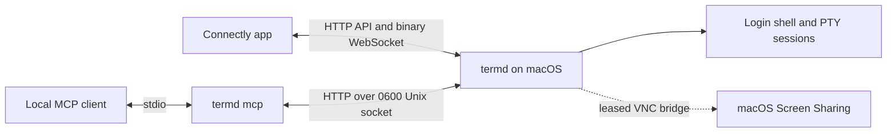

<p align="center">
  
</p>

<h1 align="center">Connectly</h1>

<p align="center">A native mobile terminal for your Mac. Run any CLI over a private connection, without SSH.</p>

<p align="center">Go · Expo · React Native · xterm.js · WebSocket</p>

## Why I built it

I use OpenCode a lot, but its remote workflow was not reliable enough for daily work. I tried three native apps and still wanted a simpler boundary. Codex has a native route, but it is not the CLI I use most. I wanted to reach the Mac's shell and run OpenCode, Codex, or any other CLI there. The terminal should belong to the machine, not to one tool.

Connectly gives me that path from a phone. A Go daemon owns the shell sessions on the Mac. The app connects over a private network, with no SSH server, CLI-specific bridge, or hosted relay in the middle.

## Architecture



The Expo app uses React Native for its interface and xterm.js in a WebView for terminal rendering. The daemon owns PTYs, session state, authentication, and Mac APIs. A binary-framed WebSocket carries terminal input and output. HTTP carries stats and configured Mac actions.

Remote requests use a bearer token. The daemon rate-limits failed authentication and audits actions without logging clipboard contents. Tailscale is the recommended network path; TLS is supported when configured. Local MCP clients use `termd mcp` over stdio and a Unix socket with mode `0600`. The MCP server shares configured actions, but has no remote port and cannot end sessions or start screen sharing.

## What it does

- Runs any CLI available in the Mac login shell through a PTY.
- Keeps sessions alive across phone disconnects and resumes them when the app reconnects.
- Supports five open terminal tabs and up to 16 daemon sessions by default.
- Shows battery, charging, lid, and load status.
- Offers allow-listed actions, clipboard and volume controls, and paths restricted to configured roots.
- Starts time-limited Screen Sharing through a short-lived, single-use VNC ticket.
- Exposes session status and configured actions to local MCP-compatible clients.

## Product decisions

I chose a PTY because it gives every CLI the same shell entry point. Connectly does not wrap OpenCode or expose an arbitrary remote-command endpoint. The phone can invoke only action IDs configured on the Mac; script paths and arguments stay in that configuration.

There is no cloud account, relay, or separate session-history database. Tailscale provides the private route, and the daemon keeps active and detached sessions in memory. Push notifications and an always-on Android background service are also out of scope because they require extra services and lifecycle behavior.

## Run it

You need a Mac with Go 1.23 or later, Node.js, and Tailscale on both the Mac and phone.

Install the daemon on the Mac with its Tailscale IPv4 address:

```bash
./daemon/install.sh <mac-tailscale-ip> [port]
/usr/local/bin/termd --print-token
```

The installer builds `termd`, creates a LaunchAgent, and installs the narrow `sudoers` rules for sleep control and Screen Sharing. The default port is `7681`.

Start the app:

```bash
cd app
npm ci
npx expo start --android
```

The Expo app is configured for Android and iOS. Enter the Mac's Tailscale IP, port, and token on the Connect screen.

## Configure Mac actions

Actions are disabled unless enabled in `~/.config/connectly-termd/actions.json`:

```json
{
  "clipboard": true,
  "volume": false,
  "roots": ["~/Projects"],
  "actions": [
    {
      "id": "run-tests",
      "label": "Run tests",
      "kind": "script",
      "target": "~/bin/run-tests.sh",
      "timeoutSec": 300
    }
  ]
}
```

Action kinds are `app`, `path`, `shortcut`, and `script`. Scripts must be executable. Restart `termd` after changing the file:

```bash
launchctl kickstart -k gui/$(id -u)/dev.connectly.termd
```

To add the local MCP server to Claude Code, run `claude mcp add connectly -- /usr/local/bin/termd mcp`. Other local MCP clients can launch the same stdio command.

## Strengths and limits

Connectly is strongest as a direct, CLI-agnostic terminal with controlled Mac actions. Sessions live in daemon memory, so they survive phone disconnects but not daemon restarts. Detached sessions are removed after 24 hours by default. The app reconnects in the foreground, but does not keep a reliable background connection alive.

The terminal renderer and noVNC load pinned packages from jsDelivr, so the phone needs internet access to load them. Screen viewing depends on macOS Screen Sharing and account authentication. It is view-and-tap only, without a remote keyboard. A lease expires after five minutes by default; if Screen Sharing was already on, Connectly leaves it on.

Lid-closed operation depends on macOS power behavior and the `sudoers` rule from `install.sh`. Test it on the target Mac before relying on it. Do not expose the daemon to the public internet. Use Tailscale or configure TLS and a private firewall.

## License

Connectly is released under the [MIT License](LICENSE).
